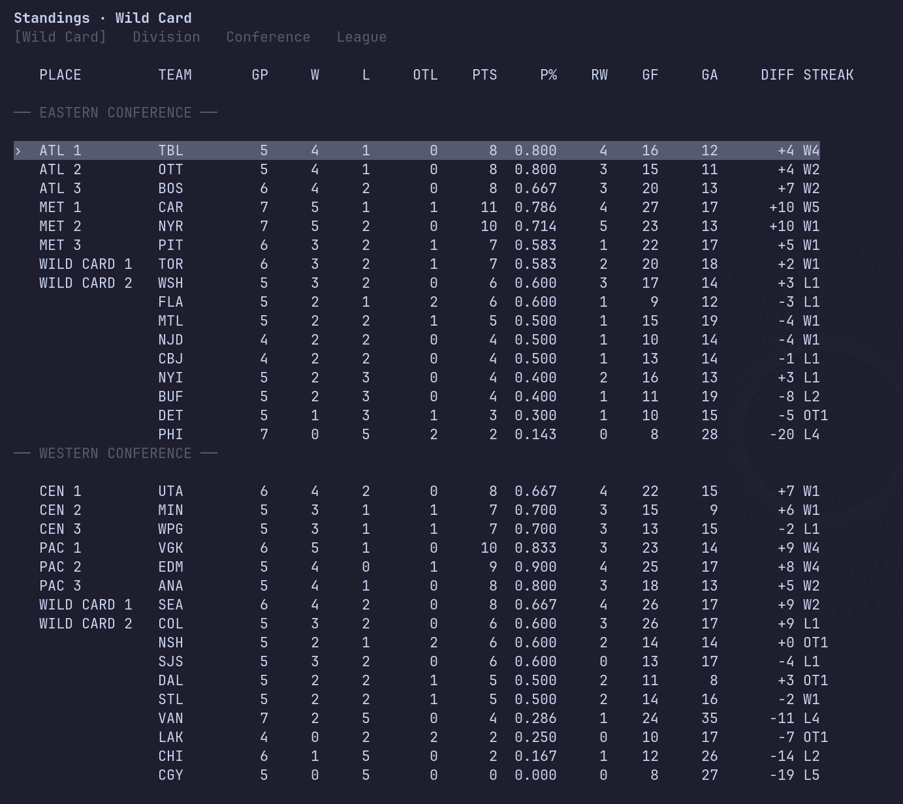

# NHL Stats Vim

A terminal interface for NHL hockey. It uses Vim-style
navigation throughout its lists and event feed, with context-sensitive tabs,
in-place refreshes, and common controls visible in the footer.



Licensed under the [MIT License](LICENSE). See [third-party notices](THIRD_PARTY_NOTICES.md) for dependencies.

```sh
docker run --rm -it ghcr.io/malvore/nhl-stats-vim:v0.1.0
```

The container starts the interactive TUI directly; no SSH server or key files
are needed for local use.

Press `enter` on the welcome screen to browse scores by date. Open a game for
its summary, player box score, and full play-by-play. Browse any team to see
its schedule, roster, and season stats; open players for profiles and game
logs. League standings and skater/goalie leaders are available from anywhere.
The application talks directly to public NHL JSON services and uses ESPN's
public injury feed for roster and player status. It needs no database or
browser UI.

```text
NHL Stats Vim  ·  Scores  ·  Mon, Oct 5, 2026 ET

PHI    0      TBL    2                   2nd 13:29
OTT    2      BOS    0                   1st 02:12
NSH           TOR                        7:00 PM
```

Press `enter` on the welcome screen for Today. The footer shows common
controls, and `?` opens full help.

## Vim-style navigation and keys

On lists and feeds, `j` moves down, `k` moves up, `gg` goes to the first
item, and `G` goes to the last.
The arrow keys remain alternatives to `j`/`k`. A single `g` waits for the
second `g` and does not move the selection.
The current list item is marked with a visible `›` cursor; it moves as soon as
you press `j` or `k`. The game event feed scrolls immediately with those keys.

| Screen | Keys |
| --- | --- |
| Welcome | `enter` scores; `a` all teams; `L` league leaders; `s` standings |
| Scores | `↑`/`↓` or `k`/`j` select; `[`/`]` or `h`/`l` change date; `t` returns to today; `enter` opens a game |
| Gamecenter | Visible Summary, Box Score, and Play-by-Play options; `tab` or `h`/`l`/`←`/`→` switches views; `enter` opens a selected box-score player; `f` toggles key events in play-by-play |
| Standings | Wild Card is the first/default view; `tab`/`l`/`→` moves across Wild Card, Division, Conference, and League; `shift+tab`/`h`/`←` moves back; `enter` opens a team |
| All teams | Select a club and press `enter` for its team view |
| Team | `h`/`l`/`←`/`→` switches Recent, Schedule, Roster, and Stats. In Stats, `tab` focuses the skater/goalie options and `h`/`l` changes them; `f` remains an alias. `enter` opens a game or player. Skaters start in points order and goalies in save percentage order. |
| Player | Browse the game log; `enter` opens a game |
| Leaders | `tab` focuses the group or metric option row; `h`/`l`/`←`/`→` changes the focused option. `m` remains a metric alias. On goalies, `u` toggles a games-played qualification filter; `enter` opens a player. |
| Anywhere | `gg`/`G` first/last; `a` all teams; `L` leaders; `r` refresh; `?` help; `esc`/`backspace` back; `q` quit |

The default 80-column layout keeps scores and statistics in aligned columns.
Rows and headers clip cleanly in narrow terminals. Live scores and Gamecenter
data refresh in place; `r` forces a refresh. The leaders view shows the top
100 players for its selected regular-season metric. Skater leaders default to
points and goalie leaders to save percentage. The optional goalie filter keeps
players with at least two games and at least half as many games as the busiest
goalie in the returned top 100. The filter applies to those returned players.
Injury codes are `DTD`, `IR`, `LTIR`, and `OUT`. Roster and player views show
when the ESPN feed was last checked, or when it is unavailable. A blank injury
cell means no matching report was available; it does not prove the player is
healthy.

## Run locally

Go 1.27.2 or newer:

```sh
go run ./cmd/nhl-stats-vim
# or
go build -buildvcs=false -o nhl-stats-vim ./cmd/nhl-stats-vim && ./nhl-stats-vim
```

SSH mode is optional. It requires an OpenSSH `authorized_keys` file with at
least one allowed public key and a stable SSH host private key. Keep both
outside Git. Only the `nhl` SSH username is accepted. No password auth, shell,
command execution, or subsystems are provided.

```sh
NHL_STATS_VIM_AUTHORIZED_KEYS=/secure/authorized_keys \
NHL_STATS_VIM_HOST_KEY=/secure/ssh_host_ed25519_key \
NHL_STATS_VIM_LISTEN=:2222 ./nhl-stats-vim serve
```

The server times out idle connections after 30 minutes and sessions after four hours. Each SSH connection gets its own Bubble Tea model. Server logs are structured JSON. A shared cache is capped at 256 entries and 12 MiB.

## Container

```sh
docker build -t nhl-stats-vim:local .
docker run --rm -it nhl-stats-vim:local
```

The image contains a single static Go binary with CA roots and Eastern
timezone data. For SSH service mode, explicitly pass `serve` and mount your
keys read-only:

```sh
docker run --rm -p 2222:2222 \
  -e NHL_STATS_VIM_AUTHORIZED_KEYS=/keys/authorized_keys \
  -e NHL_STATS_VIM_HOST_KEY=/keys/ssh_host_ed25519_key \
  -e NHL_STATS_VIM_LISTEN=:2222 \
  -v /absolute/path/to/keys:/keys:ro \
  nhl-stats-vim:local serve
```

Connect with `ssh -p 2222 nhl@localhost` using an authorized client key.
Verify the server host key through a trusted channel on first connection.
The SSH service is stateless and needs no database or Kubernetes API access.

## Data sources

The app requests NHL web and statistics JSON endpoints directly and ESPN
injury data when roster or player status is shown. These feeds are unofficial
integration points for this project; they can change or be unavailable. This
repository is not affiliated with or endorsed by the NHL or ESPN. Check the
providers' terms before redistributing their data or hosting a public live
instance. Live data access is intended for personal, noncommercial viewing.
The MIT license covers this project's code, not provider data or marks. A
hosted public demo has not been cleared for live data.

Source paths and synthetic response examples are in `internal/nhl` and its
tests. Responses have timeouts, bounded retries, and contextual
errors; `r` retries a failed screen. Optional Gamecenter and team data load
separately from the primary game or schedule, and failures appear on screen.
The [coverage and research roadmap](docs/DEPTH_ROADMAP.md) records the next
sources to validate for advanced stats, recaps, and media.
